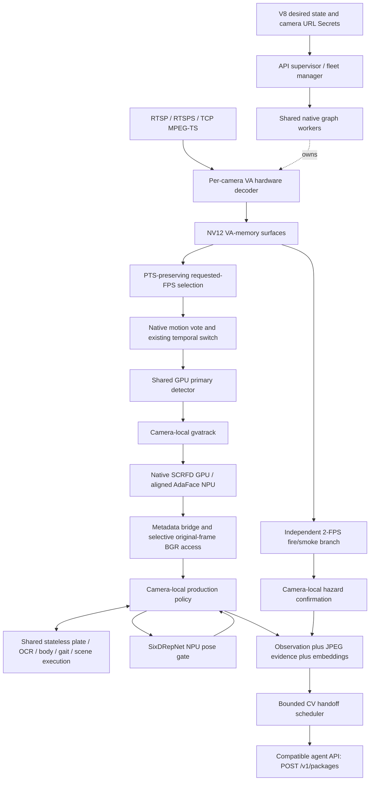

# Sentry V8 Opt79 isolated-host validation report

Date: 2026-11-05. Branch: `sentry_cv_multi`.

**Measured campaign complete; the image has confirmed defects.** The ledger contains 123 runtime cases, including deliberate failures and excluded test attempts, plus validator, policy, receiver, artifact and Kubernetes checks. The two-camera hour met the rate and independent freshness criteria. State retirement, UTC timestamp mapping and several failure-handling paths need correction before a production release. Recognition accuracy and downstream Management are outside scope.

## 1. Goal and boundary

Measure the frozen optimized pipeline on `192.168.1.64` with competing application workloads stopped. Preserve the V8 contract, models, production gates, camera-local associations, original-frame evidence and hardware execution.

The user explicitly set the delivery boundary at the compatible agent API. This campaign checks complete multipart packages, observation/evidence/vector links, exact image bytes and hashes, acknowledgements, retries, duplicate handling and pressure. Production-agent database durability and downstream Management ingestion, search, image retrieval and incident handling are outside scope. Recognition accuracy is separate from this execution campaign.

Passing an API accounting check does not mean every candidate was admitted. Passing a rate check does not establish freshness or recognition accuracy. These distinctions matter for the defects below.

## 2. Frozen image and software

| Item | Tested value |
|---|---|
| Image | `localhost/sentry-v8-opt79-shared-gait-background:latest` |
| Original Podman configuration ID | `f82a0769ed12eff25ef7bdabc9619370ebfdceeed737eaed21e5f2381e4feb86` |
| Original local manifest digest | `sha256:03d82a6c021781484c4d476aeb229dc08bbb9068467fba701d2c157bc19e8cfa` |
| Imported Docker configuration ID | `sha256:626ef9f4ff8d04ab4ce9553c43d9a754d5fa1e0dd047850774a70887d2b09aeb` |
| Export/import equivalence | All 45 rootfs diffIDs and critical runtime configuration fields match |
| Desired state | `sentry-v8`, schema `8.0` |
| CV-to-agent handoff | Protocol `1.0`, Unix-socket `POST /v1/packages` |
| Observation/evidence/embedding wire schemas | `7.0` inside the V8 handoff architecture |
| OpenVINO Python | `2026.2.0-21903-52ddc073857-releases/2026/2` |
| DL Streamer package | `2026.2.0` |
| Policy SHA-256 | `95f244203f6e53c949624925315c4d36ca07de040acdf03ffbdbfd831a832d03` |
| Canonical versus baked policy/schemas | 11 of 11 checked files match byte hashes |

The transport changed the configuration/manifest representation. It did not substitute a rebuilt runtime. The local manifest above is not a newly published registry digest.

The production-policy file retains its historical filename, `SENTINEL_V6_PRODUCTION_POLICY.md`. Embedding profile names containing `v18.1` identify embedding spaces. Neither changes the desired-state contract version.

## 3. Hardware, isolation and power conditions

The target is an Intel Core Ultra 9 285H system with 16 logical CPUs, 30.836 GiB usable RAM (33,109,463,040 bytes), no swap, Ubuntu 24.04.4 LTS / kernel 7.0.0-30-generic, Intel GPU and Intel NPU. GPU and NPU devices are exposed through `/dev/dri` and `/dev/accel/accel0`.

Competing application workloads, including the original Kubernetes workload, were stopped. SSH, networking, time synchronization, thermal management and the container runtime were retained. Temporary service guards prevented the original orchestration from automatically returning during measurement.

Stock-power cold starts repeatedly reached the CPU's reported critical-temperature region and triggered the campaign's protective stop. Reducing PL2 alone did not resolve that observation. The main `a4-turbo-off-*` series therefore uses **CPU turbo disabled, PL1 45 W and PL2 65 W**. This is a conditional test configuration, not a stock-power capacity claim or a diagnosis of the cooling system. Transitional runs are excluded from capacity qualification.

Original CPU turbo/PL2 settings were restored and the temporary Docker socket ACL was removed after measured work; independent readback confirmed restoration. Application workloads remain stopped under the user's isolation instruction; final restoration instructions will identify the affected services.

## 4. Actual execution architecture



Tracking, presence IDs, recovery, zone episodes, counts, dwell, candidate selection and temporal confirmation remain camera-local. Compiled model execution is shared within a native worker group. A native worker failure can affect its group; a source outage and a native process failure have different isolation boundaries.

Primary detection uses VA-surface sharing. Secondary images still require crop preparation and copies into persistent inference executors. Busy use cases can require frequent full-frame BGR access. This is not zero-copy execution for every model.

Gait uses one full-resolution background update per eligible camera/frame and reuses that mask across people. Per-person crops, morphology, movement checks and sequence selection remain independent. This authorized learning-cadence change is not a claim that the new masks equal the older repeated-update masks.

## 5. One-hour execution result

Case: `a4-turbo-off-stress-60min-all-2x8-yuv420`.

The actual steady hold was configured for 3,600 seconds after startup/warmup. It collected 360 steady samples; the first-to-last sample span is 3,590.232 seconds because samples are approximately ten seconds apart. The controller completed the case at `2026-11-05T00:05:49Z`.

Two independent marked sources were used: crowd at 1920×1080/30 source FPS and vehicles at 1280×720/10 source FPS. Both requested 8 processing FPS and retained all use-case bindings, including scene search and its images.

| Observation | Result |
|---|---:|
| Raw harness | Pass |
| Timestamp-matched whole-run inference FPS | 7.980 and 8.000 per camera |
| Final decoder states | Both healthy |
| Decoder reconnects | 0 |
| Fatal log entries | 0 |
| Retry exhaustion / protocol errors | 0 / 0 |
| API capture packages | 70,913 |
| API capture JPEG evidence objects | 20,761 |
| JPEG bytes accepted | 2,494,801,191 |
| API capture embeddings | 6,410 |
| Face / body / gait / scene embeddings | 547 / 2,024 / 211 / 3,628 |
| First / last steady CV cgroup memory | 3,161.88 / 3,422.27 MiB |

The last sampled handoff counters were 70,885 admitted, 70,883 acknowledged and two coalesced packages. The capture totals were collected later, through shutdown. These are different cutoffs and must not be subtracted to claim lost packages.

All matched approximately ten-second inference windows exceeded 7.65 FPS, above the proposed 7.2-FPS window floor. Independently marked scene-package p95 latency was 404 ms / 583 ms; p99 was 504 ms / 644 ms, with no missing or ambiguous markers among 3,628 saved scene images. This passes throughput and freshness for the tested workload. It does **not** pass clean resource/timestamp qualification: retained gait history grew, late memory growth continued, and reported UTC event times were ahead of API receipt.

## 6. Agent-API accounting proof

The separate common-cutoff test paused producers, drained the CV scheduler and compared the API receiver against CV acknowledgement counters.

| Check | Result at the same cutoff |
|---|---:|
| CV admitted / acknowledged packages | 201 / 201 |
| API unique accepted package IDs | 201 |
| Unique observation/evidence/embedding objects | 421 |
| Sequence range | 1–421, contiguous |
| Evidence bytes accepted | 8,813,886 |
| Embeddings accepted | 77 |
| Pending / exhausted / protocol errors | 0 / 0 / 0 |

The receiver validates package and component schemas, parent links, actual multipart parts, byte lengths and SHA-256 hashes before acknowledgement. Later receiver versions additionally require exact equality between promised and supplied artifact IDs. The completed gallery audit checked 16,925 saved packages, 10,108 JPEGs and 6,765 embeddings with zero errors. JPEG types were 6,679 full frames, 2,910 subject crops and 519 face crops. Dimensions were face 512D, body 384D, gait 4096D and scene 768D, with normalization close to one. This saved gallery is a subset of accepted traffic; the receiver validates all accepted schemas/bytes.

The acknowledgement label `durable` is part of the local protocol. This reference receiver does not establish a separate production agent's SQL durability or anything after the API boundary.

## 7. Measurement definitions and corrections

The health field named `decoded_fps` reports selected frames. Raw decoder throughput is derived separately from accepted plus dropped counters at the native PTS selection gate.

Camera counters are cached. Dividing their changes by HTTP poll intervals can fabricate dips. One apparent 6.595-FPS interval contained 66 frames over **8.147 seconds of camera-snapshot time**, approximately 8.101 FPS. The final audit matches exact counter tuples to the independent 1-Hz observer and uses camera snapshot timestamps. Missing/reset/misaligned intervals remain unqualified. Original harness results are preserved separately.

Independent frame markers measure first video-PES submission at the replay sender to complete-package acceptance at the API. They exclude physical camera capture/encoding and post-API work. Source-PTS-to-UTC estimates, last-frame receive age and zero-clamped runtime latency are not substitutes for this measurement.

Stage wall times, queue waits, candidate-confirmation windows and hardware busy time are different measurements. Primary metadata-bridge time is not YOLO kernel latency. Gait background subtraction is not GaitBase inference. Parent/child stages overlap and must not be added as independent elapsed time.

CPU usage is reported as cgroup cores and node capacity. Shared worker RSS/PSS is deduplicated by PID. GPU non-RC6 activity is not engine compute utilization; independent engine counters are reported in section 14. NPU busy time is node-scoped. Unsupported GPU/NPU temperature or per-camera hardware-utilization measurements remain unavailable.

## 8. Confirmed defects and limitations

| Area | Evidence and impact |
|---|---|
| UTC event-time mapping | In the hour, 3,626 of 3,628 scene observations had `observed_at` later than API acceptance; median signed receipt-minus-observation was −7.868 seconds. Independently marked video remained fresh. The source-PTS-to-UTC mapping is therefore unsuitable as an accurate occurrence-time/latency reference in this test. Exact upstream cause is not established by the timing audit. |
| Gait history retirement | Hour ended with 1,205 retained crowd presences, 13,682 silhouettes and 4,710 track centres. Expired lifecycle state is removed without corresponding gait-history eviction. The silhouette payload was 38,528,512 bytes; it does not explain all cgroup growth. |
| Feature state after rejected admission | Actual baked producer records face/body/gait sample quality after `persist()` returns false. An equal-quality replacement is then suppressed after admission recovers. This is distinct from permitted finite retry exhaustion. |
| Fractional FPS | Desired 4/8.5/10 resolves to camera targets 4/8/10 while top-level aggregate remains 22.5. The schema accepts a value that the native path truncates. |
| Nested log redaction | Five of six synthetic cases pass. Worker nested structured extras retain dummy credentials; no actual credential leak was demonstrated. |
| Telemetry I/O interrupts analytics | Making only the metrics directory unwritable caused six unhandled camera-thread exceptions in telemetry/face-metrics writers. Both cameras recovered after permission restoration. |
| Secret URL rotation is not applied | Supervisor reports revision 2 after a source change, but all 937 captured packages remain revision 1 and all 64 scene images retain the old 1920×1080 source rather than the replacement 1280×720 source. A rate-only harness pass does not qualify this reconciliation. |
| Adaptive native tracking | Resolved legacy distance/disappearance fields are not applied to native `gvatrack` association. Adaptive presence/zone/quality behavior is separate. |

HTTP/HTTPS rejection is also confirmed: configuration accepts them, but native `_probe_source()` raises `UnsupportedSurfaceSource`. Camera membership removal/addition eventually applied revisions 2/3 and resumed output, but native `longjmp` termination messages occurred during worker replacement. Overloaded eight-camera 720p processing also produced a native `CL_OUT_OF_RESOURCES` error. Preserve these errors; neither is recognition accuracy. None of these defects was patched in the frozen image during this campaign.

## 9. Motion and hazard observations

The ordinary quiet recording, with all bindings enabled, selected approximately 8 FPS but inferred about 0.2 FPS; the remaining frames were quiet policy observations. The quiet→crowd→quiet recording exercised both active and quiet processing. A separate fire clip produced two suspected and two cleared transitions.

Uniform blank video behaved differently: the exact native diagnostic returned a smoke score of about 0.3716, above the 0.35 collection threshold but below the event gate. A weak collection positive can retain inference without producing a hazard event. The same three-frame native probe was repeated on the target with identical primary-empty/smoke-score results; this is not a reason to silently change safety gates to improve a capacity score.

## 10. Recorded effective policy and device placement

These are the crowd camera's resolved settings near the end of the hour, not universal thresholds for every camera. The resolver selected tolerant collection for presence, zones, counts, ANPR and identity, and balanced fire/smoke. No defaults were tuned during this campaign.

| Area | Recorded effective settings |
|---|---|
| Presence | Four confirming hits; unobserved after 5 seconds; unknown ending after 20 seconds |
| Zone transition | Normalized boundary margin .018; four votes and .8-second hold |
| Visible count | Four-observation / .8-second debounce; 20-second heartbeat |
| ANPR | 3.5-second selection window; OCR final confidence .35 plus two supporting reads; single-read exception .82; minimum plate 16×5 pixels; sharpness 5 in the implementation's metric |
| Identity | Face quality .30 and minimum width 28 source pixels; 2.5-second selection; body quality .20 and minimum 28×56 source pixels; 24 gait silhouettes; five-second minimum feature cooldown |
| Fire/smoke | .65 event confidence; five positives in three seconds; clear requires ten seconds and five evaluated negatives, resetting on evaluation gaps over 2.5 seconds |
| Scene | Desired-state active interval two seconds; pressure multiplier 1; event-trigger cooldown one second; quiet operation follows the existing roughly five-second sweep |

A minimum feature cooldown is not a periodic instruction to send unchanged embeddings. Face/body/gait qualification and material improvement remain necessary. Track loss is not positive zone exit, and an unknown ending must not manufacture confirmed dwell completion.

The telemetry's resolved tracking values of 320 pixels and nine seconds are legacy centroid settings; they are not applied to native GVA association. The full recorded resolver output is saved in `inventory/hour-effective-policy.json`.

| Execution | Recorded device |
|---|---|
| Decode / primary person-vehicle detection | GPU VAAPI / GPU DL Streamer VA surfaces |
| Native tracker | CPU `gvatrack` |
| Face detection / alignment-AdaFace / pose | GPU / NPU / NPU |
| Plate detection / OCR | NPU / `MULTI:GPU,NPU` |
| Body / gait | NPU / NPU |
| Scene / fire-smoke | GPU / GPU |

`MULTI:GPU,NPU` does not establish an exact OCR work split. Missing GPU/NPU and masked-primary tests fail explicitly; CPU availability in OpenVINO's device list is not evidence of model fallback. Per-model CPU helper work, tracking, cropping and JPEG encoding are expected.

## 11. Coverage and exclusions

The complete per-case numeric table is [MEASUREMENT_TABLES.md](optimization_evidence/2026-11-05-isolated-host/final/MEASUREMENT_TABLES.md). Original harness flags are retained beside timestamp-corrected rates. A deliberately disconnected camera must not be described as a failed capacity experiment merely because the harness expected every camera to receive video.

| Plan area | Executed checks and outcome |
|---|---|
| A — isolation / instruments | Hardware/driver/device/plugin inventory; competing workloads stopped; independent cgroups, CPU temperature/power, GPU engines and NPU busy counters. Conditional power settings recorded and restored. Unsupported accelerator temperature/per-camera hardware utilization remain unavailable. |
| B — contract / initialization | 75 baked runtime tests passed; 30 injected-observation V8 policy scenarios passed; 26 configuration/Secret checks passed; 1/8/16/50 accepted and 51 rejected; nine corrected profiles validated; 11 policy/schema hashes match. Fractional FPS, Secret rotation and membership errors are reported above. Numerous complete container startups exercised lifecycle cleanup; no claim of a controlled cache-cold three-cycle compile benchmark. |
| C — sources / media | Probed 19 supplied endpoints: 14 reachable and five TCP endpoints timed out at preflight. Tested RTSP/RTSPS H.264/HEVC, reachable TCP H.264, five logical consumers of one TCP URL, portrait/nonaligned/720/1080/1440/4K diagnostic, 15/25/30-source FPS, omitted/default and mixed FPS. TCP HEVC fails the current H.264-assuming path. HTTP/HTTPS fail native selection; local-file Secret is rejected, while offline fixtures are replayed through supported TCP. |
| D — rates / bundles / overload | Progressive camera/FPS/resolution and scene/identity/vehicle/mixed/all profiles; request sharing/group size 4/5; frozen opt76/opt79 and background rollback pairs; empty→busy→empty overload. Failing branches were stopped rather than repeatedly escalating to 50 actual cameras. Results below are workload-dependent. |
| E — production behavior | Live/recorded presence, counts, ANPR, face/body/gait, scenes and hazards produced output. Injected observations cover boundary jitter, actual crossing, positive exit versus unknown loss, recovery, dwell episode fields, shared polygons, independent modalities, original-frame best-face selection and correction/suppression. This establishes exercised code behavior, not labelled tracking/OCR/recognition accuracy. |
| F — agent boundary | Strict multipart/schema/link/hash checks; common-cutoff 201/201 reconciliation; duplicate/conflict tests; 429/503/400/401, lost ACK, slow API, socket absence/permissions, agent pause/restart. Rejected-feature state is a confirmed producer defect. Production-agent database and downstream Management are outside scope. |
| G — telemetry | Selected/admitted/quiet/event counters; camera freshness and decoder state; stage wall/queue timers; process/shared-worker and container memory/CPU; node GPU/NPU counters. Kubernetes cgroup limits/current memory verified independently. Cached-counter and GPU-log parser mistakes were corrected in offline tools; raw evidence is preserved. |
| H — motion / hazards | Quiet safety sweep, quiet→crowd→quiet, fire suspected→clear, and Kubernetes quiet→active→quiet passed execution checks. Blank-video weak smoke correctly retained inference without meeting the hazard event gate. Sensor-unavailable periods are not negative hazard evidence. |
| I — artifacts / state | Actual saved JPEG byte/hash/dimension/link/bounds and normalized-vector audits passed; representative images reviewed. Gait array production/reuse tested, with explicit visual-quality limitations. Link/provenance checks do not prove the same physical identity across cameras. |
| J — stress / failure recovery | Genuine 3,600-second hold; separate 5/15/30-second source interruptions, 10/45-second worker pauses, worker/container restart, CPU quota, bounded memory pressure, read-only metrics, bad peer/source, bandwidth cap and source/config updates. Source recovery and peer isolation exercised; unrestricted natural single-model deadlock recovery remains unproven. |
| K — prior optimization regressions | Default native batch/request path preserved; bounded ordering/old-session regression coverage retained; selective pixel access and original-coordinate evidence remain; gait shared-mask rollback compared; native group fault boundary tested at 20+1 low-rate scene cameras. Quiet 21-camera execution is not 21 busy-camera capacity. |
| L — deliverables | Image/software/policy/schema fingerprints, commands/configurations, corrected rates, latency/resource/fault tables, plots, API payload examples, actual patched test tools, handoff and cleanup records retained. |

The campaign does not cover every possible camera, packet-loss pattern, weather condition or indefinitely long operation. Some useful checks were deliberately diagnostic: missing hardware/model, unsupported inputs and interrupted sources are expected negative cases; the first malformed profiles/4:4:4 markers and disposable-cluster port collision are invalid test setups, preserved and superseded. Natural native hangs, production device-plugin security and labelled recognition accuracy are not inferred from manual process pauses or successful frame production.

## 12. Capacity with scene search on every camera

All rows below retain the configured two-second active scene samples, JPEGs and 768D vectors. Quiet mode keeps the existing roughly five-second safety sweep. Rate PASS requires every camera's cumulative inference at least 95% of target and every qualified roughly ten-second window at least 90%. It does not by itself pass freshness, memory, timestamps or release qualification.

| Profile / source | Cameras × requested FPS | Matched per-camera inference FPS | Rate criterion | CV RAM p95 MiB | CV CPU p95 cores |
|---|---:|---:|---|---:|---:|
| All / crowd 1080p | 1 × 8 | 8.00–8.00 | PASS rate | 2706.05 | 1.17 |
| All / crowd 1080p | 2 × 8 | 8.00–8.00 | PASS rate | 3177.51 | 1.77 |
| All / crowd 1080p | 4 × 8 | 7.98–8.06 | PASS rate | 4052.32 | 4.24 |
| All / crowd 1080p | 2 × 10 | 10.00–10.23 | PASS rate | 3245.98 | 2.35 |
| All / crowd 1080p | 4 × 10 | 9.36–9.87 | FAIL rate | 4107.26 | 4.72 |
| All / crowd 1080p | 6 × 8 | 6.34–6.65 | FAIL rate | 4992.72 | 6.28 |
| All / crowd 720p | 4 × 8 | 7.96–7.97 | PASS rate | 3223.73 | 2.82 |
| All / crowd 720p | 8 × 8 | 5.76–6.10 | FAIL rate | 4292.53 | 5.05 |
| All / crowd 1440p | 2 × 8 | 8.00–8.29 | PASS rate | 3933.64 | 2.33 |
| All / crowd 1440p | 4 × 8 | 7.44–7.58 | FAIL rate | 5448.46 | 4.97 |
| All / crowd 1440p | 4 × 10 | 7.67–7.94 | FAIL rate | 5359.06 | 4.72 |
| Scene / crowd 1080p | 8 × 8 | 7.91–8.00 | PASS rate | 2157.52 | 4.56 |
| Scene / crowd 1080p | 12 × 8 | 5.64–6.07 | FAIL rate | 2739.55 | 5.87 |
| Identity + scene / crowd 1080p | 4 × 8 | 7.94–8.00 | PASS rate | 3331.81 | 3.69 |
| Identity + scene / crowd 1080p | 8 × 8 | 5.26–5.40 | FAIL rate | 4755.09 | 6.75 |
| Vehicle + scene / marked ANPR 720p | 2 × 8 | 7.99–8.00 | PASS rate | 1995.49 | 1.73 |
| Vehicle + scene / marked ANPR 720p | 3 × 8 | 8.00–8.02 | PASS rate | 2344.91 | 2.39 |
| Vehicle + scene / original ANPR 720p | 4 × 8 | 7.38–7.57 | FAIL rate | 2694.01 | 3.06 |
| 25% identity-role mix + scene | 4 × 8 | 7.99–8.01 | PASS rate | 3483.71 | 3.16 |
| 75% identity-role mix + scene | 4 × 8 | 7.99–8.01 | PASS rate | 3505.82 | 3.77 |

The marked ANPR lower-boundary inputs contain instrumentation pixels and are not bit-identical to the original unmarked four-camera input. Camera count/use-case/resolution alone cannot describe demand: people per frame, vehicle/plate candidates, mask preparation, face pose and selected evidence also matter.

The strongest sustained operating evidence is **two cameras × 8 FPS, all bindings, one hour**, with independent freshness. Four 1080p cameras × 8 FPS additionally passed a short marked rate/freshness check. Four 1440p cameras are not qualified: the original tests missed rate, and a marked repeat achieved rate while two cameras accumulated multi-second stale video. Two 10-FPS cameras passed a short rate test; four missed the criterion. Eight scene-only cameras passed short rate checks; twelve missed. Those are observed brackets, not hardware maxima.

For planning, use two all-use-case 8-FPS cameras as the demonstrated sustained workload; fix the confirmed defects before release. Treat four 1080p/8-FPS cameras as a short-test candidate requiring sustained mixed-content validation. There is no measured headroom factor that justifies promising 16 busy all-use-case cameras at 8/10 FPS. Schema acceptance of 50 cameras remains distinct from hardware capacity. No universal deployment count is approved by this report.


## 13. Independent latency, scene cadence and UTC mapping

The figures below measure first source video-PES submission to complete-package acceptance at the agent API. Physical capture/encoding, post-API handling and remote Management are excluded. No markers were missing or ambiguous in these valid runs.

| Run | Steady scene samples | Per-camera scene p95 range | Worst scene p99 | Interpretation |
|---|---:|---:|---:|---|
| One-hour mixed 2×8 | 1,796 + 1,794 | 404–583 ms | 644 ms | Fresh throughout the measured hour; no accumulating source backlog |
| Scene-only marked 720p, 1×8 | 25 | 394 ms | 396 ms | Short scene-path diagnostic |
| Marked 1080p30, all, 4×8 | 103 | 540–797 ms | 1,052 ms | Short rate and freshness check passed |
| Marked 1440p, all, 4×8 | 101 | 1,576–6,225 ms | 6,496 ms | Two cameras fail freshness despite acceptable cumulative FPS |
| Marked vehicle role, 2×8 | 50 | 509–561 ms | 572 ms | Short lower-boundary rate/freshness pass |
| Marked vehicle role, 3×8 | 75 | 841–1,027 ms | 1,186 ms | Short lower-boundary rate/freshness pass |

The hour produced 1,815/1,813 scene packages per camera including startup/shutdown. Source timestamp gaps were normally exactly two seconds; one four-second gap occurred on camera 2. API interarrival p95 was 2.136/2.125 seconds, with maxima 2.361/3.826 seconds across the complete capture. This is an achieved cadence, not an unconditional exact two-second transport guarantee.

Selected full-frame ANPR evidence permits a different latency measurement: the best-candidate window intentionally adds observation age. In the two-camera marked vehicle test, 64 steady plate reads had p95 3.929 seconds and 70 unsuccessful outcomes p95 3.949 seconds. At three cameras, 95 reads had p95 4.247 seconds and 102 outcomes p95 4.022 seconds. Scene latency remains separate; it must not be mixed with candidate-confirmation delay. Face/body crops lack a readable full-frame marker, so no independent physical-source percentile is fabricated for them.

**UTC mapping failed.** Scene `observed_at` was in the future at API receipt in 3,626 of 3,628 hour samples, median by 7.868 seconds. The baked `SourcePtsClock` anchors media PTS once and reanchors on backward jumps; the audit establishes incorrect occurrence-time mapping in this replay, but not a complete upstream cause. A signed future timestamp must not be silently turned into a zero-latency success. Relative frame IDs, source progression and independent sender markers remain useful; absolute event UTC and cross-camera timing need correction/validation.


## 14. Hour resources, retained state and stage costs

| Measurement | Actual result / scope |
|---|---|
| CV CPU, steady sampled p50 / p95 | 1.678 / 2.037 cores; p95 about 12.7% of this 16-logical-CPU host, not 203.7% of the whole machine |
| CV memory, steady p50 / p95 / maximum | 3,365.38 / 3,422.27 / 3,423.51 MiB |
| Memory first→last steady | 3,161.88→3,422.27 MiB, +260.39 MiB |
| Memory regression slopes | Whole steady 2.840 MiB/min; last 30 min 1.759; last 10 min 2.082. Slopes include allocator/state effects; direct unpruned gait history is independently confirmed |
| CPU package temperature, steady mean / p95 / max | 60.07 / 68 / 77 °C under turbo-off/PL2-65-W condition |
| CPU package power, steady mean / p95 / max | 16.82 / 18.27 / 19.49 W |
| GPU non-RC6 node activity, mean / p95 | 70.35% / 74.3%; activity/residency, not compute engine usage |
| Independent GPU Compute engine p50 / p95 | 24.34% / 30.02% |
| Independent Video / VideoEnhance engine p95 | 1.59% / 3.72%; engines overlap and must not be summed |
| NPU node busy, mean / p95 / max | 34.83% / 42.24% / 50.43% |
| GPU/NPU temperatures, per-camera hardware % | Not available / not established; no fabricated attribution |
| Handoff retention | Bounded scheduler; observed queue spikes up to eight packages, no hour retry exhaustion/protocol errors |

The crowd camera retained 1,205 gait presence histories, 13,682 silhouettes and 4,710 track centres at the end; silhouette payload alone was 38,528,512 bytes (36.74 MiB). Vehicle camera retained 48 histories, 108 silhouettes and 963 centres. Presence retirement does not evict the corresponding gait dictionaries. Fixing that lifecycle must preserve legitimate recovery grace and remove retired sessions/aliases, rather than discarding history immediately on temporary loss. Allocator releases occurred during the hour, so the whole heap is not described as monotonically leaking; direct retained-state growth is still a real defect.

The following are **lifetime mean wall times per recorded call**, with queue/preprocessing/policy overlap. They are not individual kernel p95s and must not be summed.

| Stage | Crowd camera mean ms | Vehicle camera mean ms | Meaning |
|---|---:|---:|---|
| Selective original-frame BGR access | 19.467 | 12.884 | Pixel materialization/conversion; source resolution matters |
| Active event-policy span | 38.745 | 15.686 | Includes child work; overlap with asynchronous work |
| Gait background update | 69.852 | 38.971 | CPU preprocessing, called on eligible frames; reused across people |
| Gait processing wrapper | 25.708 | 32.164 | Mixed preprocessing/sequence work per call, not GaitBase kernel time |
| Body embedding wrapper | 22.643 | 23.039 | Model-call wall-time abstraction |
| Face pose | 4.592 | 3.600 | SixDRepNet model-call wall time |
| Plate detector wrapper | 8.067 | 7.168 | NPU detector call including wrapper work |
| OCR submit→callback | 19.832 | 18.051 | Asynchronous completion wall time |
| Scene embedding wrapper | 18.667 | 20.143 | Includes work beyond the persistent executor timing |
| JPEG encoding | 5.290 | 4.643 | Selected evidence encoding |

Primary/fire metadata-bridge timers are not model kernel latency. Full individual-invocation timing samples were not exported by this frozen image; the supplemental JSON records distributions of unique cached window means explicitly, rather than mislabelling them per-call p50/p95/p99. The detector's 640×640 input does not remove source-resolution decode, conversion, full-frame background subtraction or evidence costs.


## 15. Failures, recovery and configuration semantics

| Scenario | Observed result |
|---|---|
| 15/30-second source outage | Target recovered while peer remained healthy. Five-second outage was buffered enough that the harness reconnect-counter predicate failed; feeder connection count still demonstrated transport reconnect. |
| Unavailable/corrupt source at startup | Good peer continued producing packages. Failed camera reported unavailable/degraded; shared API remained alive. No healthy `count=0` is inferred from an unavailable camera. |
| Same TCP source, five consumers | About 7.94–8.03 selected FPS each; 27–28% quiet duty; 219 scene vectors, 224 images, 301 packages, no fatal log entries. This is mixed-motion fan-out, not five fully busy-camera capacity. |
| 10/45-second native worker pause | Persistent-source retake and longer manual pause recovered; whole-case FPS can include catch-up and cannot prove uninterrupted freshness. Automatic recovery from a natural single-model deadlock remains unproven. |
| Native worker kill / container restart | Restart paths recovered. The 21-camera 1-FPS scene diagnostic showed 20 cameras affected in the killed group and the 21st remaining healthy; eventually all recovered. |
| 429 / 503 for 15 seconds | Finite retry budget exhausted four packages in each recorded case; releases were before API acceptance. This is visible retry behavior, not silent loss after an accepted ACK. |
| 400 / unexpected 401 | Recorded nonretryable/protocol rejection. The 401 test introduces no CV authentication dependency. |
| Lost ACK | Duplicate ACKs with stable IDs/digest/bytes/sequences; no protocol errors in that fault case. |
| Slow API / agent pause | Bounded retention/backpressure; pause recovered. Admission rejection remains subject to the feature-state defect above. |
| Socket absence / permissions / agent restart | Restored communication and processing; finite pre-ACK exhaustion visible. See exact counters and timelines in fault-summary.json. |
| One-core CPU quota / bounded memory pressure | Restrictions applied and restored; final cameras healthy. Intentional restricted intervals are excluded from capacity claims. |
| Read-only metrics directory | Six camera-thread exceptions from metrics writers. Recovery after permission restoration does not make the interruptions acceptable. |
| Valid geometry / malformed or stale config / unreadable Secret | Good revision applied; invalid desired state lowered global readiness while last good workers continued. Restoration recovered readiness. |
| Secret URL replaced + revision 2 | Supervisor claimed revision 2, but all 937 captured observations retained revision 1 and old-source dimensions. Confirmed reconciliation failure. |
| Remove/add camera | Actual packages reached revision 2/3 and final cameras healthy; native longjmp termination messages during replacement remain a lifecycle error. |
| 8-camera overload / empty→busy→empty | Missed useful rate under load; native OpenCL resource error in one high-load case. Final healthy flags alone do not qualify sustained capacity or backlog recovery. |

The original ten-second pause used a one-client sender that exited on disconnect; its eventual source reconnection failure was confounded. The retake used persistent senders and is the recovery evidence. Invalid attempts remain saved. No artificial stuck-kernel recovery or production-agent crash durability is claimed.

## 16. Frozen-image and gait-background comparisons

Same declared source, camera count, target FPS, bindings and host power condition were used in each pair. No model/gate tuning occurred. The background rollback intentionally changes foreground learning cadence; output masks/embedding accuracy are not claimed identical.

| Pair | Matched lowest–highest camera FPS | CV CPU p95 cores | Rate result |
|---|---:|---:|---|
| Opt79, background OFF, 4×1080p8 | 7.47–7.73 | 4.890 | Miss |
| Opt79, background ON, 4×1080p8 | 7.96–8.00 | 3.903 | Pass |
| Opt79, background OFF, 4×1440p8 | 4.73–5.28 | 4.736 | Miss |
| Opt79, background ON, 4×1440p8 | 7.06–7.35 | 4.862 | Miss, improved throughput |
| Frozen opt76, 2×1080p8 | 8.03–8.05 | 2.473 | Window criterion missed |
| Frozen opt79, 2×1080p8 | 8.00–8.01 | 1.836 | Pass |
| Frozen opt76, 4×1440p8 | 5.40–5.47 | 4.784 | Miss |
| Frozen opt79, 4×1440p8 | 7.13–7.85 | 4.945 | Miss, improved throughput |

At 1080p, gait-processing lifetime means were approximately 71–73 ms/call with rollback and 28–30 ms/call with shared background. Shared update calls can individually take longer while being performed fewer times; per-call background means alone are a misleading speedup metric. Supplemental comparison data includes call counts and attributed work per admitted frame, keeping overlapping stages separate.

The offline gait gallery produced 163 nonempty arrays. Inspected examples include block-like and fragmented foreground; array validity is not clean-silhouette or recognition-quality certification, and this sparse offline helper is not the native event's exact selected sequence. Accuracy remains a separate evaluation.

## 17. Kubernetes and health verification

The corrected disposable k3s test passed with the unchanged frozen image, source Secret, desired-state ConfigMap, shared Unix socket and reference agent sidecar. It observed actual API package revisions **1 and 2**, not just a health revision. The projected geometry update appeared in about **51.06 seconds**. With all use-case bindings, counter evidence showed quiet, a substantial inference burst after quiet, then quiet again.

Independent host cgroup inspection of the CV container found `cpu.max=400000 100000`, `memory.max=8589934592` and 196 tasks. `/healthz` reported 4.0 CPU cores, 8,192 MiB memory limit and 196 tasks. Direct `memory.current` was 2,677,374,976 bytes (about 2,553.34 MiB); the nearby cached API sample was 2,553.84 MiB. CRI working-set memory is a different quantity and is not expected to equal total cgroup memory. CPU snapshots likewise use different windows.

`/healthz` and `/metrics` were reachable; `/healthy` returned 404. No alias was introduced. Readiness/liveness probes were retained. Device access in this integration used privileged access with UID 10001 and render/video groups; this does not qualify a production Intel device-plugin/nonprivileged security configuration.

The first disposable cluster attempt collided its kubelet health port with its own cloud controller and failed before image execution. Its logs are preserved as a test-setup failure. The retake changed only test ports and skipped already-completed performance cases. Original cluster data/configuration were not used; its node credential fingerprint was preserved.

## 18. Reproduction, artifacts and next work

The frozen image was imported, not rebuilt. Per-case `command.json`, `case.json`, desired state, final health, reports, source logs and compressed accepted-package records are retained remotely. The reproduction ZIP contains the **actual patched harness/receiver/tools** and canonical schemas, with SHA-256 inventory; passwords, tokens, private kubeconfig and node credentials are excluded.

A representative supported replay command is:

```bash
python3 scripts/isolated_validation/probe_case.py \
  --case reproduction-2x8 --profile all \
  --root /home/admin1/Documents/sentry-validation \
  --image localhost/sentry-v8-opt79-shared-gait-background \
  --cameras 2 --fps 8 --port 18080 \
  --startup-timeout 150 --warmup-seconds 15 \
  --steady-seconds 90 --sample-seconds 10 \
  --minimum-decode-ratio 0.90 --full-usecases \
  --recording /home/admin1/Documents/sentry-validation/fixtures/crowd-1080p.mp4
```

The hour uses two explicitly recorded marked fixtures and marker-sender overrides; its exact command/overrides are in its saved command.json. Senders use compressed stream copy into independent TCP connections, not CV-container software encoding/decoding. Reproduce the stated power/isolation conditions before comparing numbers; the host's original settings have now been restored.

Local evidence root: [optimization_evidence/2026-11-05-isolated-host/final](optimization_evidence/2026-11-05-isolated-host/final/). Important files:

- [All numeric measurement tables](optimization_evidence/2026-11-05-isolated-host/final/MEASUREMENT_TABLES.md), [matched rates](optimization_evidence/2026-11-05-isolated-host/final/window-rate-audit.json), [analysis](optimization_evidence/2026-11-05-isolated-host/final/analysis.json).
- [Hour/resource/stage supplement](optimization_evidence/2026-11-05-isolated-host/final/report-supplement.json), [fault timeline](optimization_evidence/2026-11-05-isolated-host/final/fault-summary.json), [JPEG/vector audit](optimization_evidence/2026-11-05-isolated-host/final/artifacts/gallery-audit.json).
- [Desired-state example](optimization_evidence/2026-11-05-isolated-host/final/desired-state.example.json), [real package example index](optimization_evidence/2026-11-05-isolated-host/final/example-package-index.json), [representative ACKs and receiver checks](optimization_evidence/2026-11-05-isolated-host/receiver-check/results.json).
- [Model/device/plugin fingerprints](optimization_evidence/2026-11-05-isolated-host/final/artifacts/preflight/devices-models-plugins.txt), [actual reproduction tools](optimization_evidence/2026-11-05-isolated-host/final/reproduction-tools.zip), [hash inventory](optimization_evidence/2026-11-05-isolated-host/final/reproduction-tools-sha256.json), [detailed handoff](OPTIMIZATION_HANDOFF.md).

All raw evidence remains at `admin1@192.168.1.64:/home/admin1/Documents/sentry-validation`; the local mirror is intentionally compact. Temporary host settings, service isolation and final cleanup are documented separately below. No image/code/schema/model push was performed by this validation campaign.

The next implementation should address the concrete internal defects in this order: UTC mapping and source-URL revision reconciliation; feature state committed after failed admission; gait state retirement; metrics I/O isolation; nested redaction and safe native worker replacement; HTTP/native-input mismatch and fractional-FPS semantics. Preserve the V8 wire contract and agreed production gates. After fixes, rerun the corresponding finite regressions and the demonstrated busy operating points; another broad architecture rewrite is not justified by these measurements.

## 19. Cleanup and restoration

Final inspection found no campaign processes, replay senders, monitor jobs or running campaign Docker containers. Both disposable cluster directories, including their private credentials, were removed after verifying no mounts/processes remained. The temporary node-credential backup was removed after fingerprint verification; the original node credential was preserved. CPU turbo was restored (`no_turbo=0`), PL2 restored to 115 W, sustained PL1 remained 45 W, and the temporary Docker socket ACL was removed. The local reference-transfer RAM archive/staging were removed. The tested CV image is unchanged.

Competing application services remain stopped to leave the requested isolated box. They were not silently restarted. The service inventory records original/after states. Temporary guards remain only under `/run/systemd/system/{k3s,apexfabric-control,meshcentral,meshagent,gdm}.service.d/99-sentry-validation-isolation.conf`; these files deliberately prevent automatic return during the campaign. When returning this machine to ordinary service, remove **only those campaign-created guards**, remove any campaign runtime masks, reload systemd, and start the services that were previously active. Do not remove the original `/etc` unit files or original Kubernetes data.

The recorded stopped services include AnyDesk, ApexFabric control, cron, GDM, the original k3s, MeshCentral/MeshAgent and PostgreSQL. User `sentry-cv`/`sentry-cv-ui` services and update timers were also stopped for isolation. Restore them deliberately when the test box should resume normal work. Existing SSH, networking, Tailscale, Docker and thermal management were retained.

The later compressed-input progress probe did not export a frame counter with this FFmpeg stream-copy/null-output path, so its numeric source FPS remains unavailable. Its media-time progression is not substituted for frame rate, and a nonconcurrent later probe cannot establish the earlier live-source cause. The raw attempt with an unsupported timeout option is retained as invalid instrumentation. The GPU JSON parser was corrected to accept both concatenated and comma-separated samples; the final independent-engine report uses 20,836 samples, not the earlier five-sample partial parse. These are test-tool corrections, not runtime changes.

See [cleanup-final.json](optimization_evidence/2026-11-05-isolated-host/final/inventory/cleanup-final.json) and [restoration-final.json](optimization_evidence/2026-11-05-isolated-host/final/inventory/restoration-final.json). The image still requires the concrete fixes in section 8; completing the validation campaign is not a production-release approval.
