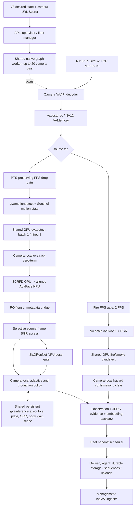

# Sentry V8 opt57 Pipeline Technical Report

Date: 2026-11-04. Repository branch: `sentry_cv_multi`.

This report describes the implementation and measured behavior of the latest local optimized image, using the structure of `dlstreamer-pipeline-technical-report.md`. It incorporates the subsequent busy-camera tests at 8 and 10 FPS, which narrow the earlier capacity conclusions.

## 1. Scope and status

| Item | Current image |
|---|---|
| Image | `ghcr.io/kiranmaibattu-cyber/sentinel-cv-runtime:intel-285h-2026.11.04-v8-opt57-zero-term` |
| Image ID | `c029bd7769a93f8b769da77b20c5acbc7a528e8f54a6cde74393a2639658c2a0` |
| Local manifest digest | `sha256:778703017d9c20515d171928e180e10b5b6f1a6cf7fa8b17590ae82021968691` |
| Local image size | 3,502,155,658 bytes; registry transfer size may differ |
| Desired-state contract | `sentry-v8`, schema `8.0` |
| Ingest wire schema | `7.0`, uploaded by the delivery agent |
| CV-to-agent protocol | `1.0`, Unix-socket package handoff |
| Hardware tested | Intel Core Ultra 9 285H, 16 logical CPUs, approximately 31.6 GB RAM, Intel GPU and NPU |
| Packaging | Models and model-proc files baked into image; non-root user `10001:10001` |
| Publication | Local build verified; registry publication was not performed by the optimization task |
| Current qualification | Working integrated candidate with unresolved failures under busy multi-camera workloads |

Implemented functions include vehicle/person detection, GVA tracking, motion gating, adaptive event gates, presence and recovery, zone entry/exit, visible counts, line crossing, dwell episode evidence, face pose/embedding, body ReID, gait, ANPR, scene embeddings, fire/smoke, health telemetry, and complete output-package handoff.

The image is more than the reference detector benchmark: it executes evidence selection, JPEG encoding, identity/plate candidates, lifecycle logic and delivery admission. These consume resources and affect capacity.

**The passing 20-camera result used a quiet recording at 4 FPS per camera. It does not qualify 20 busy cameras at 8 or 10 FPS. Later busy-camera tests exposed throughput loss, camera timeouts and a secondary-model failure.**

## 2. Libraries, SDKs and hardware interfaces

| Component | Actual role |
|---|---|
| Intel DL Streamer 2026.2.0 | Native `gvadetect`, `gvaclassify`, `gvainference`, `gvatrack`, `gvamotiondetect` |
| OpenVINO Python 2026.2.0-21903 | Model inspection, direct SixDRepNet inference and supporting runtime code; GVA uses OpenVINO underneath |
| GStreamer / Python GI | Shared parent graph, independent camera bins, queues, tees, appsrc/appsink, pad probes and bus dispatch |
| GStreamer VA plugins / Intel iHD | `vah264dec` / `vah265dec`, `vapostproc`, NV12 `VAMemory`, hardware decode and surface sharing |
| `gstgva.VideoFrame` | Read ROI boxes, classes, tracking IDs and output tensors |
| Intel GPU | Decode/postprocessing, primary detection, face detection, fire/smoke, plate detector and scene encoder |
| Intel NPU | Fused face alignment/AdaFace, SixDRepNet, body ReID and GaitBase |
| OpenVINO `MULTI:GPU,NPU` | Configured OCR execution target; per-device OCR scheduling is not established by this string alone |
| OpenCV Python 4.14.0 | Crops, quality measurement, resizing, silhouettes and JPEG generation |
| Pillow / NumPy | Established body resize behavior, tensor preparation and embedding normalization |
| Native VA conversion libraries | Access retained source surfaces and materialize BGR pixels when required |
| FFprobe / FFmpeg | Source probing and qualification replay senders; required native graph does not silently switch to software decode |
| V8 handoff scheduler | Bounded package admission, retry, priority scheduling and Unix-socket delivery-agent communication |

The current graph does not use the reference's `gvapython Stash -> Secondary` path or `gvafpscounter -> fakesink` output. Python policy receives appsink/metadata results and creates V8 packages. Health telemetry supplies the production rate counters.

## 3. Integrated architecture

### 3.1 Visual graph



### 3.2 Sharing and isolation boundaries

Each camera has its own decoder, motion switch, GVA tracker, timestamp clock, presence registry, zone episodes, OCR history, face candidate selection, gait buffers and event policy.

The worker shares compiled GVA model instances and persistent secondary executors. Native camera branches are capped at 20 per process; configured deployments above that size are partitioned into additional workers. The desired-state maximum is 50 cameras. Neither value is a hardware capacity guarantee.

API supervision and the fleet handoff scheduler sit outside camera policy. TCP camera reconnection preserves the existing shared inference graph. A native process crash can still affect the cameras assigned to that process; source-outage isolation does not prove isolation from a GPU/native process crash.

### 3.3 Pixel and metadata boundaries

Primary inference consumes VA surfaces through `pre-process-backend=va-surface-sharing`. Detection and tracking return source-coordinate metadata. BGR conversion occurs when policy needs original-frame crops, image quality samples, scene images or evidence.

Secondary executors receive BGR images through `appsrc`; their `_infer_direct()` implementation copies `image.tobytes()` into a GStreamer buffer. Fire uses a bounded 320x320 BGR branch. The implementation therefore has primary surface sharing and selective conversion, rather than zero-copy for every model.

## 4. Elements, properties and actual scheduling

### 4.1 Input and decode

RTSP/RTSPS:

```text
rtspsrc location=<Secret URL> protocols=tcp latency=100
  ! rtph264depay ! h264parse ! vah264dec name=decoder
  ! vapostproc ! video/x-raw(memory:VAMemory),format=NV12
```

H.265 uses `rtph265depay`, `h265parse` and `vah265dec`.

TCP MPEG-TS:

```text
reconnecting compressed-byte socket feeder
  -> appsrc name=tcpappsrc is-live=true format=bytes
       block=false max-bytes=1048576 leaky-type=downstream
       caps=video/mpegts,systemstream=true,packetsize=188
  ! tsdemux ! h264parse ! vah264dec name=decoder
  ! vapostproc ! video/x-raw(memory:VAMemory),format=NV12
```

TCP uses H.264 MPEG-TS as its current input assumption and skips a separate FFprobe connection. The feeder has a 5-second connect timeout, 30-second read timeout and 1-second retry delay. It reports connection/disconnection/byte counters and structured reconnect logs.

MP4/MOV/M4V local files use `filesrc -> qtdemux -> parser -> VA decoder`; local raw streams use `filesrc -> parser -> VA decoder`.

**Input support gap:** desired-state validation accepts HTTP/HTTPS, but `_probe_source()` in the required native surface path rejects these schemes. HTTP/HTTPS cannot currently be claimed as working on the default opt57 graph. The successful TCP and RTSPS tests do not cover HTTP.

### 4.2 Configured FPS selection

`identity name=fpsgate` has a `DlsPtsRateGate` buffer probe. It selects frames using source PTS at the desired camera FPS without rewriting timestamps. Extra decoded surfaces are dropped before primary inference. The decoder may still decode the compressed source at its incoming rate.

The gate replaced `gvafpsthrottle`, which had paced surplus source frames and caused stale video processing in earlier candidates. Desired camera FPS is a selection target; measured inference FPS depends on motion admission and downstream ability to keep up.

### 4.3 Motion gate

```text
gvamotiondetect name=motion
  pixel-diff-threshold=15 motion-threshold=0.05 block-size=64
  confirm-frames=1 min-persistence=1 max-miss=0 min-rel-area=0.0005
  ! identity name=policygate
```

The native element supplies motion votes. `SurfaceSwitch` supplies the temporal policy: default confirmation is 4 votes in a 14-observation window; six fully evaluated negative model observations release active inference; quiet mode runs a safety sweep approximately every 5 seconds. Positive detections retain/wake inference. Startup begins active.

The native numeric motion properties above are literal graph values. Temporal settings come from the internal processing gate configuration. They should not be described as universally learned camera-specific thresholds.

Quiet observations advance lifecycle/health processing without asserting new detector observations. In this DLS path, scene pixels are available on admitted frames/safety sweeps: active scene bindings can target 2 seconds, while quiet output follows the approximately 5-second sweep. It is not an unconditional two-second scene-image guarantee in quiet mode.

### 4.4 Primary detection

```text
queue max-size-buffers=2 max-size-bytes=0 max-size-time=0
  ! gvadetect name=primarydet
       model=/models/traffic/openvino/vehicle_yolo26n_fp16_static_b1.xml
       model-proc=/opt/traffic-pilot/config/vehicle_yolo26_model_proc.json
       device=GPU pre-process-backend=va-surface-sharing
       threshold=0.30 nireq=8 batch-size=1
       model-instance-id=<shared worker/model scope>
```

Preprocessing uses aspect-ratio resize, RGB, range `[0,1]`, padding `[114,114,114]`, and `yolo_v26` conversion. Classes are `bus, car, minivan, motorcycle, rickshaw, truck, bicycle, person, others`; person is mapped to the existing internal pedestrian representation.

`nireq=8` is request concurrency. The integrated primary model is batch one. Experimental dynamic batching code remains in the repository, but the required DLS path does not use that older shared-YOLO client.

### 4.5 Tracking and metadata

```text
gvatrack tracking-type=zero-term
```

Tracking runs on the CPU with independent state per camera. `GvaTrackerMetadataStage` reads its IDs and maintains hit/age bookkeeping; it does not perform a second association. Final appsink uses `max-buffers=1 drop=false` to avoid losing outputs for frames already admitted by motion policy.

The effective image environment is `SENTINEL_GVA_TRACKER_TYPE=zero-term`; a later Docker `ENV` overrides an earlier compatibility value. Fixed MOT17 evaluation favored zero-term over zero-term-imageless, but tracking identity switches remain a known limitation.

**Adaptive integration limit:** presence/zone/ANPR/identity/hazard policy resolves camera-specific modes, but opt57 does not pass the legacy centroid tracker's adaptive distance/disappearance values into `gvatrack`. GVA association uses its selected mode/default configuration. Adaptive telemetry alone does not prove native tracker parameters change with it.

### 4.6 Face cascade and pose

```text
gvadetect name=facedet
  model=/models/face/openvino/dlstreamer/scrfd_top1x_u8.xml
  device=GPU pre-process-backend=va-surface-sharing
  inference-region=roi-list object-class=person
  inference-interval=3 threshold=0.55 nireq=4
  model-instance-id=<shared face-detector scope>
  ! gvaclassify name=faceclass
      model=/models/face/openvino/dlstreamer/face_align_u8.xml
      device=NPU pre-process-backend=opencv object-class=face
      nireq=4 model-instance-id=<shared face-embedding scope>
```

The fused model performs landmarks/alignment and AdaFace embedding. A metadata probe retains face boxes and vectors before downstream conversion. Candidate processing then uses original-frame pixels for quality, contextual evidence and SixDRepNet pose.

Pose defaults: absolute yaw <=35 degrees; pitch <=25; roll <=25. Pose input context ratio is 0.20. Quality combines detector confidence, source-pixel size, sharpness, exposure and pose quality. UI evidence is a clipped square approximately twice the largest face-box dimension.

The adaptive face scheduler reduces candidate/pose processing after a good sample and seeks material improvements. Native SCRFD/AdaFace elements still have their own interval (`3` eligible admitted buffers); this scheduler does not suppress every native embedding computation.

The `FaceSample.chip` produced by the metadata adapter is a resized face-box crop. The actual aligned tensor used by the fused AdaFace model is internal to that model and is not exported as this chip. Embedding provenance must not treat the resized UI chip as proof of the exact aligned model input.

### 4.7 Fire/smoke

```text
source tee -> queue leaky=downstream max-size-buffers=2
  -> identity firefpsgate (PTS drop probe: 2 FPS)
  -> vapostproc add-borders=true
  -> BGRx 320x320 -> videoconvert -> BGR
  -> gvadetect device=GPU pre-process-backend=opencv
       threshold=0.35 nireq=2 shared model-instance-id
  -> appsink firesink max-buffers=2 drop=true
```

The model-proc uses `yolo_v8` conversion with `fire` and `smoke` labels. Policy consumes evaluated observations, confirms suspected episodes and requires sustained evaluated negatives for clearing. Unavailable or unevaluated video is not negative evidence.

The BGR branch was retained because concurrent primary/face/fire VA preprocessors caused iHD resource failures during integration. It remains a deliberate conversion cost.

### 4.8 Shared secondary execution

Each stateless secondary model has a persistent engine keyed by model path, model-proc, geometry and device:

```text
camera crop / qualified tensor montage
  -> per-camera queue in shared model engine
  -> round-robin owner selection
  -> appsrc BGR
  -> gvainference pre-process-backend=opencv nireq=1
  -> appsink result drop=false
  -> copied output tensor -> original camera policy
```

There is one worker thread per engine, one default pending job per camera owner, and a 30-second timeout. Calls wait for completion; sharing reduces duplicate model instances but can block camera policy under load. OCR adds its own bounded asynchronous queue. This mechanism differs from the reference's globally rate-limited 0.7-FPS secondary branch.

## 5. Baked model inventory

Shapes and quantization evidence below were read from the current local IR XML files. Interface precision does not establish execution precision for every layer.

| Function / file | Input -> output | Graph precision evidence | Effective target / requests | Scheduling |
|---|---|---|---|---|
| Vehicle/person `vehicle_yolo26n_fp16_static_b1.xml` | `[1,3,640,640]` -> `[1,300,6]` | F32 input, FP16 constants; 0 FakeQuantize | GPU, GVA, 8 requests, batch 1 | Configured FPS after motion admission |
| Fire `smoke_fire.xml` | `[1,3,320,320]` -> `[1,6,2100]` | I8 constants, 66 FakeQuantize | GPU, GVA, 2 requests | Independent 2 FPS branch |
| SCRFD `scrfd_top1x_u8.xml` | U8 `[1,3,320,320]` -> `[1,1,6]` | FP16 constants; 0 FakeQuantize | GPU, GVA, 4 requests | Every third eligible admitted buffer, person ROIs |
| Fused `face_align_u8.xml` | U8 `[1,3,192,192]` -> `[1,512]` | Mixed constants; 103 FakeQuantize | NPU, GVA, 4 requests | Per face emitted by native cascade |
| SixDRepNet `best_a0_fp16.xml` | `[1,3,224,224]` -> rotation `[1,3,3]` | FP16 constants; 0 FakeQuantize | NPU, direct OpenVINO | Scheduled face candidates; produces pitch/yaw/roll |
| Plate `license_plate.xml` | `[1,3,224,224]` -> `[1,300,6]` | FP16 constants; 0 FakeQuantize | GPU, shared gvainference, 1 request | Eligible vehicle crop processing |
| OCR `ocr.xml` | `[1,3,64,128]` -> `[1,15,37]` | FP16 constants; 0 FakeQuantize | MULTI:GPU,NPU, shared gvainference, 1 request | Qualified plate crop submission |
| TransReID `transreid_ssl_int8.xml` | `[1,3,256,128]` -> `[1,384]` | I8 constants, 128 FakeQuantize | NPU, shared gvainference, 1 request | Qualified due body sample; internal target about 1 second per track |
| Gait wrapper `gaitbase_dlstreamer_montage.xml` | `[1,3,320,264]` -> `[1,256,16]` | I8 constants, 19 FakeQuantize | NPU, shared gvainference, 1 request | Qualified sequence; wrapper restores 30x64x44 temporal input |
| SigLIP2 `siglip2-base-patch16-224-static.xml` | `[1,3,224,224]` -> `[1,768]` | FP16 constants; 0 FakeQuantize | GPU, shared gvainference, 1 request | Scene interval/event triggers/optional subject semantic sample |

Wire embedding profiles remain AdaFace 512D, TransReID 384D, GaitBase 4096D and SigLIP2 768D. Existing profile names containing `v18.1` identify embedding spaces; they are not the container/contract version.

Gait uses background-subtraction silhouettes and a GaitBase model. It requires motion and enough usable silhouettes; segmentation is preprocessing, not a replacement for embedding inference.

### 5.1 Principal model SHA-256 fingerprints

| Model | XML SHA-256 | BIN SHA-256 |
|---|---|---|
| Primary static B1 | `cc8f2bd6c99cbb3dda6155401a5baa9eb5745d1a67cdf0844c411876be5e3447` | `c0963ec2396e8d49d9a4814719b97cd259017b8350bcb132800fc159d0bea13d` |
| Fused face | `48d79c6bd1c3841016051314ca31a7135abb78eb4f54a2c12f93de700d05ad82` | `4e6571eb76a301d884e3ac7917089fd93dda0a45e3c4aaae90c6da5c49e63148` |
| Body ReID | `63384268f74a2882cfe1201740680ed692bf39336207c844eb6fe4578354ad2b` | `365b5f0cf216cb2a5c80f3901c27528489c6e9b1bb91ab7b20a525a6c76a224e` |
| Gait wrapper | `04875a8cd4106df7c2fc57a13645429de619ebbd9beabdad8b12fe79da415ef8` | `0b7424fdcd872ae098a033d1d78f4580c46425cbc362be4854c04742678cea45` |
| Scene static | `8a30f23917e7ea1bb3d66a5dff310962579bdf2f59cb644cccf1d9c352579799` | `63fcf9c810604de707b66b02eb54bf9d302f3ac40c3570806494a97f9a2152f9` |

Production-policy document SHA-256: `95f244203f6e53c949624925315c4d36ca07de040acdf03ffbdbfd831a832d03`.

## 6. Production policy, outputs and delivery

### 6.1 Observations and evidence

| Use case | Output behavior | Evidence / embeddings |
|---|---|---|
| Person/vehicle presence | `object_present` after confirmation, then approximately 60-second refresh for a qualifying observed presence | First observation uses source-pixel `subject_crop`; optional subject SigLIP vector if bound; refresh is not guaranteed a new image |
| Presence continuity | `track_lost`, `presence_recovered`, `presence_ended_unknown` | Lifecycle metadata; loss does not itself establish zone exit |
| Zones / dwell | Positive `zone_entry` / `zone_exit`; presence carries `zone_episodes` | Transition frame, source geometry, episode ID and observed-inside timestamps; Management derives dwell with observation gaps |
| Person/vehicle counting | `zone_count`, meaning visible-now count in bound scope | Stable changes plus 20-second heartbeat; no mandatory image on every measurement |
| Entry/exit lines | `line_cross` after geometric/temporal checks | Source frame and direction/line/presence identifiers |
| ANPR | Best-candidate `plate_read`; explicit `plate_outcome` when no accepted read; guarded updates | Frame evidence with plate geometry/text and vehicle association; original-frame vehicle/plate crops are internal model inputs |
| Person identity | Separate `person_feature_sample` for qualified face/body/gait | Contextual face crop or subject crop, corresponding vector/profile, quality and presence association; gait includes sequence provenance |
| Scene search | `scene_sample`, interval or configured trigger | Full source frame or rectangular zone-bounds crop plus 768D vector |
| Fire/smoke | `fire_smoke_suspected`, later `fire_smoke_cleared` | Suspected episode frame evidence; clear is a transition observation |
| Health | `camera_health` and `/healthz` | Availability/freshness/errors/reconnect metrics |

Polygon scene crops use the axis-aligned bounding rectangle of the polygon; pixels outside the polygon inside that rectangle are not masked.

An already visible subject first observed inside a zone establishes an episode with an unobserved entry time; policy does not manufacture an outside-to-inside transition. Track/presence IDs remain local to camera/session. Management links identities across cameras using modality evidence.

### 6.2 Representative adaptive defaults

The resolver starts in balanced mode, evaluates at approximately five-second intervals and maintains separate use-case modes. Selected effective values are visible in `/healthz`.

| Gate | Strict | Balanced | Tolerant collection |
|---|---:|---:|---:|
| Presence stable hits | 3 | 3 | 4 |
| Base unobserved / unknown timeout, seconds | 2 / 8 | 5 / 18 | 5 / 20 |
| Zone margin, normalized | .008 | .012 | .018 |
| Zone confirmation votes / hold seconds | 2 / .25 | 2 / .50 | 4 / .80 |
| Count debounce observations / seconds | 2 / .25 | 2 / .25 | 4 / .80 |
| ANPR candidate window, seconds | 1.5 | 2.5 | 3.5 |
| OCR emission confidence / supporting reads | .40 / 3 | .35 / 2 | .35 / 2 |
| ANPR single-read confidence | .88 | .82 | .82 |
| Plate minimum width x height, pixels | 32x8 | 22x7 | 16x5 |
| Plate sharpness threshold | 20 | 8 | 5 |
| Face emission quality / minimum width | .40 / 48px | .30 / 32px | .30 / 28px |
| Body quality / minimum size | .25 / 40x80 | .20 / 32x64 | .20 / 28x56 |
| Minimum gait silhouettes | 20 | 20 | 24 |
| Hazard emission confidence / confirmations | .62 / 4 | .65 / 5 | .70 / 6 |

All three hazard profiles require 10 seconds and at least five evaluated negatives to clear, resetting negative progress for an evaluation gap above 2.5 seconds. These numbers describe implementation defaults, not calibrated probabilities or universal camera optima. Presence timing has additional view-dependent logic.

Identity emission requires first qualification or material quality improvement, with a five-second minimum cooldown: face improvement .10, body .15, gait .20. A cooldown alone does not cause a new embedding event. ANPR model collection confidence defaults to .35, provisional OCR to .25; these are distinct from the adaptive final acceptance gates. Plate updates have a five-second cooldown and additional correction/conflict checks.

### 6.3 V8 handoff and remote endpoints

The CV runtime submits one multipart logical package to `POST /v1/packages` over `/run/sentinel-delivery/agent.sock`. It includes observation JSON, evidence metadata/bytes, embeddings, stable IDs and package digest.

Fleet scheduler defaults: 8 retained packages, 256 MiB retained bytes, 4 replaceable packages, 128 MiB replaceable bytes, 4 concurrent requests, 64 MiB maximum request and 30-second request timeout. Retry delays are .25/.5/1/2/4 seconds. Priority scheduling favors hazard/lifecycle/identity work over replaceable sampling.

Only a `201 durable` or `200 duplicate` acknowledgement establishes production. The separate delivery agent owns SQLite, sequence allocation, credentials, remote retry and upload acknowledgement persistence. CV memory is not the durable outbox.

The V8 contract specifies:

```text
POST /api/v7/ingest/events
POST /api/v7/ingest/evidence
POST /api/v7/ingest/embeddings
POST /api/v7/ingest/skip
GET  /api/v7/ingest/stream
```

The older opt57 qualification document's `/api/v6/ingest/*` statement is stale. The checked V8 contract uses V7 wire/ingest formats and a V8 local handoff architecture.

## 7. Exact build and test commands

Build:

```bash
cd /home/admin1/Documents/sentry_cv
SENTINEL_IMAGE_VERSION=2026.11.04-v8-opt57-zero-term \
  scripts/build_sentinel_v8_image.sh
```

The existing tag identifies the measured image above. Rebuilding later can produce different dependencies because apt/pip dependencies are not all pinned; compare image digest and model fingerprints.

Twenty-camera quiet replay qualification:

```bash
python3 scripts/v8_capacity_probe.py \
  --image ghcr.io/kiranmaibattu-cyber/sentinel-cv-runtime:intel-285h-2026.11.04-v8-opt57-zero-term \
  --cameras 20 --fps 4 --port 18080 --startup-timeout 360 \
  --warmup-seconds 20 --steady-seconds 70 --sample-seconds 10 \
  --minimum-decode-ratio 0.80 --full-usecases \
  --recording /home/admin1/Downloads/camera_recordings_2026-10-12/Camera12_192.168.1.13_2min_h264.mp4
```

Busy-camera test reproduction; select the tested camera/FPS pair:

```bash
python3 scripts/v8_capacity_probe.py \
  --image ghcr.io/kiranmaibattu-cyber/sentinel-cv-runtime:intel-285h-2026.11.04-v8-opt57-zero-term \
  --cameras 2 --fps 8 --port 18080 --startup-timeout 150 \
  --warmup-seconds 10 --steady-seconds 45 --sample-seconds 10 \
  --minimum-decode-ratio 0.90 --full-usecases \
  --recording /home/admin1/Downloads/Usecase-Catalog-main/videos/ANPR.mp4
```

The harness gives each logical camera an independent local TCP connection and runs FFmpeg with `-re -stream_loop -1 -map 0:v:0 -an -c:v copy -f mpegts -listen 1`. This preserves the recording's source rate and avoids encoding work inside the CV container. Replaying the same recording across logical cameras is not a diverse multi-camera site dataset.

## 8. Recorded results and interpretation

### 8.1 Quiet recording and operational tests

| Workload | Final selected FPS / target | Final admitted inference FPS | Container RAM | Result |
|---|---:|---:|---:|---|
| 20 cameras x 4 FPS, quiet 1080p recording, 70-second steady run | 80.167 / 80 | 27.914 | 6420.72 MB | Pass for this workload; 697/697 packages durable at sampled endpoint |
| 8 cameras x 4 FPS, same recording, ten-minute steady soak | 32.192 / 32 | 9.659 | 4135.04 MB | Pass; all eight healthy, memory stabilized; 1673/1673 durable at sampled endpoint |
| 5 cameras x 4 FPS, camera 3 interrupted 12 seconds | 19.653 / 20 | 16.811 | 3565.94 MB | Target recovered in same worker, peers healthy; 164/164 durable |
| Live TCP source, 1 camera x 4 FPS | 3.969 / 4 | 3.969 | 3193.28 MB | Pass; face/body/scene and evidence output |

Twenty-camera final CPU was 3.44 cores; node GPU active residency was 72.3%. The eight-camera soak ended at 1.332 CPU cores and 67.57% GPU active residency. These GPU numbers measure node GT activity, not isolated container compute utilization.

### 8.2 Busy 720p ANPR recording: subsequent results

All use-case bindings remained enabled, and the image/production gates were unchanged for these tests. The recording is 1280x720, 10 source FPS, 22.3 seconds, looped by the sender.

| Cameras | Desired FPS each | Target aggregate | Final selected / inferred FPS | Final RAM | Result |
|---|---:|---:|---:|---:|---|
| 1 | 8 | 8 | 8.423 / 7.927 | 3427.70 MB | Short test passed; steady windows about 7.87-8.51 FPS |
| 2 | 8 | 16 | 12.558 / 14.020 | 3465.21 MB | Failed; throughput dips and one unavailable camera |
| 1 | 10 | 10 | 10.473 / 10.473 | 3402.37 MB | Short test passed; steady windows about 9.17-10.47 FPS |
| 2 | 10 | 20 | 9.324 / 8.858 | 3357.03 MB | Failed; scene executor produced no tensor, branch restart, reduced throughput |
| 8 | 10 | 80 | 17.984 / 19.339 | 4602.92 MB | Failed; steady selected throughput about 18-42 FPS |

Selected and inference rates are independently sampled rolling counters. Pipeline in-flight work and window boundaries can temporarily make inferred FPS exceed selected FPS. A value above target in one window does not establish sustained extra capacity.

The single-camera pass criterion allowed a 10% shortfall in each of the last three windows; it is not proof of exact continuous 8/10-FPS delivery or a long-duration SLA. The two-camera 8-FPS case ended with a surface decoder timeout. The two-camera 10-FPS logs also contain OpenCL `CL_OUT_OF_RESOURCES` and `DL Streamer secondary produced no output tensor` in the scene path.

GPU activity during failed busy runs was below full saturation. Shared executor serialization, per-object processing, blocked camera loops and native inference errors require diagnosis before identifying the limiting resource. These observations do not establish a hardware maximum of one camera.

### 8.3 Use-case outputs on opt57

| Test | Observed outputs | What it establishes |
|---|---|---|
| MOT17 mapped person replay at 4 FPS | 42 body, 9 face, 1 gait embedding | Three modality paths execute and produce associated packages |
| ANPR clip at 4 FPS | 31 plate reads, 23 plate outcomes, 171 evidence objects | Read and unsuccessful-read paths execute; no labelled accuracy claim |
| Fire followed by normal footage | 2 suspected observations, 1 clear, 24 evidence objects | Temporal suspected/clear path executes; clear is not a safety declaration |
| Live TCP at 4 FPS | Face/body/scene observations and evidence | Real TCP native path works for the tested source |
| Supplied RTSPS address | RTSP DESCRIBE 404; TCP port reachable | Source path failed externally; current successful RTSPS decode is not established by this attempt |

### 8.4 Detector and tracker comparisons

The direct old-V8-dev3 versus optimized detector probe compared 199 detections across 30 sampled MOT17 frames with IoU 1.0, identical confidence and no class differences. Forty quiet Camera12 frames had no detections on either side. This checks direct detector behavior; it does not alone establish native VA preprocessing parity or complete event parity.

The earlier fixed-detection seven-sequence MOT17 test scored zero-term HOTA 31.44 / IDF1 35.18 / 463 ID switches versus zero-term-imageless 30.56 / 33.42 / 537. That is a separate historical tracker evaluation, not opt57's full-pipeline accuracy benchmark at 8/10 FPS. Tracker and lifecycle outputs still fragment on difficult scenes.

V8 runtime tests: 32 passed. V7 regression: 83 passed. V6 regression: 78 passed. Canonical/embedded V8 validators and build-time model/plugin checks passed. These tests establish covered schema/runtime behaviors; they do not override the later live-load failures.

## 9. Metrics and evidence locations

`/healthz` exposes per-camera target, selected-frame, admitted inference, quiet and event rates; source freshness; reconnect/decoder errors; stage timings; output counters; device placement; resolved policy; primary/fire drop counters; pending admissions; TCP feeder counters; and handoff state. `/healthy` is not an intended alias.

CPU cores/container memory come from cgroups. Process RSS and PSS differ from container RAM. GPU active residency is node-wide non-RC6 activity, not process-specific engine compute utilization. NPU busy time is also node-scoped. Low NPU activity in a quiet scene does not mean NPU models fell back to CPU.

Source PTS is anchored to edge wall time; `observed_at` is not delivery time. It is not automatically the burned-in camera clock, and cross-camera clock synchronization is not proven by UTC formatting. Stage wall times, queue waits, model-call times and source-to-output latency are separate metrics.

Each capacity artifact directory contains `report.json`, `healthz-final.json`, `container.log`, replay logs, desired state and package capture. Handoff counters in the sampled health endpoint can differ from the final capture because capture continues until shutdown. Do not combine those different endpoints into a loss calculation.

| Test | Local artifact directory |
|---|---|
| opt57 20 cameras at 4 FPS | `/tmp/sentry-v8-capacity-20.bnow569m` |
| opt57 eight-camera ten-minute soak | `/tmp/sentry-v8-capacity-8.ii2dwxl0` |
| opt57 camera interruption | `/tmp/sentry-v8-capacity-5.cy7oee88` |
| opt57 identity/gait corpus | `/tmp/sentry-v8-capacity-1.114i4pq2` |
| opt57 ANPR at 4 FPS | `/tmp/sentry-v8-capacity-1.zagcpcd3` |
| opt57 fire transition | `/tmp/sentry-v8-capacity-1.c538xa7l` |
| opt57 live TCP | `/tmp/sentry-v8-capacity-1.cn09vwqj` |
| Busy 1 x 8 FPS | `/tmp/sentry-v8-capacity-1.ozhimkhm` |
| Busy 2 x 8 FPS | `/tmp/sentry-v8-capacity-2.f70tlcem` |
| Busy 1 x 10 FPS | `/tmp/sentry-v8-capacity-1.z_054tpp` |
| Busy 2 x 10 FPS | `/tmp/sentry-v8-capacity-2.tosbn088` |
| Busy 8 x 10 FPS | `/tmp/sentry-v8-capacity-8.8yxhe3cl` |
| Direct detector parity | `/tmp/sentry-v8-opt56-detector-parity/report.json` |

`/tmp` is temporary storage; these references are machine-local evidence rather than published artifacts.

## 10. Comparison with the supplied DL Streamer report

| Area | Supplied native baseline | Current opt57 |
|---|---|---|
| Primary rate | Reported 20 x 10 FPS / 200 achieved | Quiet 20 x 4 selected FPS passed; busy 8/10-FPS multi-camera tests failed |
| Primary requests | 6 in recorded baseline | 8, batch 1 |
| Tracker | zero-term-imageless | zero-term |
| Face interval | 43 | 3 eligible admitted frames |
| Secondary schedule | Approx. .7 frames/s/camera; plate/body every third, scene every seventh | Per-use-case policy demand with synchronous waits on shared model engines |
| Secondary scene device | NPU | GPU |
| Plate / OCR | NPU synchronous | Plate GPU; OCR MULTI:GPU,NPU with async facade |
| Output | fakesink benchmark | Full observations, JPEG evidence, vectors and package handoff |
| Lifecycle / zones / dwell | Not established by benchmark | Camera-local production logic |
| Motion | Not described in baseline graph | Built-in motion and safety-sweep gating |
| Memory | Reported approx. 1.9 GB pipeline | Approx. 4.14 GB container at quiet eight-camera soak; approx. 6.42 GB at quiet twenty-camera test |
| Soak | Reported eight hours | Measured ten minutes on exact opt57 tag at eight quiet cameras |

The supplied baseline's measurements are reported by that document; they were not rerun for this report. Its FPS, memory scope, output work and secondary cadence differ, so it cannot be used as a direct speedup/slowdown ratio for opt57.

## 11. Production gaps and next validation requirements

1. Diagnose shared scene tensor loss, native OpenCL errors and busy-camera timeouts; establish that camera policy cannot remain blocked behind a failed secondary call.
2. Measure per-camera FPS and source age under continuous activity with varied person/vehicle density, across 720p and 1080p cameras. Retest 8/10-FPS capacity after correction.
3. Verify bounded secondary scheduling latency and stale-result handling; request sharing alone has not delivered reliable busy-camera throughput.
4. Map adaptive tracker configuration explicitly into native GVA behavior, or accurately advertise the distinction between adaptive presence recovery and fixed native association.
5. Resolve HTTP/HTTPS acceptance versus native-path rejection.
6. Validate native preprocessing, tracking, count/dwell timelines, ANPR text and evidence associations against the baseline on identical frames. Existing direct detector parity is a narrower test.
7. Add labelled ANPR/identity/hazard accuracy evaluation, longer busy-scene soak, and per-camera recall/ID-switch measurements. A camera that remains alive can still fail its useful output rate.
8. Validate with the actual durable delivery-agent sidecar and Management acknowledgements under network/restart conditions. The capacity harness acknowledges packages through a local capture agent; it does not establish end-to-end remote ingest durability.
9. Pin package versions and archive reports/configuration/model hashes with any published image. Local apt/pip builds and `/tmp` reports are insufficient for fully reproducible release evidence.

## 12. Code map

Paths below are relative to `/home/admin1/Documents/sentry_cv`.

| File | Responsibility |
|---|---|
| `docker/Dockerfile.sentinel-v8` | Dependencies, effective environment, baked models, plugin checks and entrypoint |
| `scripts/build_sentinel_v8_image.sh` | Image build wrapper |
| `newdetails/sentry-v8/` | Canonical V8 contract, schemas, examples and validator |
| `SENTINEL_V6_PRODUCTION_POLICY.md` | Retained production-policy specification |
| `edge_runtime/solution_packs/sporada_secure/runtime_v8/traffic_pilot_runtime/desired_state.py` | Desired-state validation and adaptation |
| `edge_runtime/solution_packs/sporada_secure/runtime_v8/traffic_pilot_runtime/solution_image_entrypoint.py` | API/health supervisor and worker lifecycle |
| `edge_runtime/solution_packs/sporada_secure/runtime_v8/services/worker/stream_fleet_openvino.py` | Fleet grouping, shared worker startup and branch supervision |
| `edge_runtime/solution_packs/sporada_secure/runtime_v8/services/worker/pipeline/surface_stream.py` | Source graph, motion integration, selective conversion and camera processing |
| `edge_runtime/solution_packs/sporada_secure/runtime_v8/services/worker/pipeline/multi_camera_gst.py` | Shared parent graph and camera-scoped bus/state management |
| `edge_runtime/solution_packs/sporada_secure/runtime_v8/services/worker/pipeline/dlstreamer_bridge.py` | TCP feeder, PTS/motion probes, face metadata and GVA tracking adapter |
| `edge_runtime/solution_packs/sporada_secure/runtime_v8/services/worker/pipeline/dls_secondary.py` | Persistent shared secondary engines and per-camera owner scheduling |
| `edge_runtime/solution_packs/sporada_secure/runtime_v8/services/worker/pipeline/v8_events.py` | Production outputs, identity/ANPR selection, zones/count/dwell, scenes and hazards |
| `edge_runtime/solution_packs/sporada_secure/runtime_v8/services/worker/pipeline/adaptive_policy.py` | Bounded use-case policy resolution and pressure controls |
| `edge_runtime/solution_packs/sporada_secure/runtime_v8/services/worker/pipeline/face_samples.py` | Face candidate scheduler and contextual crop selection |
| `edge_runtime/solution_packs/sporada_secure/runtime_v8/services/worker/pipeline/person_reid.py` | Body preparation and gait silhouette sequence processing |
| `edge_runtime/solution_packs/sporada_secure/runtime_v8/services/worker/pipeline/sentinel_v8_handoff.py` | CV package admission, digest, bounded scheduler and agent acknowledgements |
| `edge_runtime/solution_packs/sporada_secure/runtime_v8/services/worker/pipeline/runtime_telemetry.py` | Rates, stage timing and output telemetry |
| `edge_runtime/solution_packs/sporada_secure/runtime_v8/services/worker/pipeline/resource_metrics.py` | Resource scopes and measurements |
| `scripts/v8_capacity_probe.py` | Replays, capture acknowledgements, health sampling and capacity/isolation artifacts |
| `scripts/v8_parity_harness.py` | Direct detector and optional output-package comparison |

## 13. Assessment

Opt57 integrates shared DL Streamer execution, VA primary surfaces, selective pixel access and V8 production output. Its strongest demonstrated operational result is the stable quiet-scene soak and quiet twenty-camera workload. Busy multi-camera testing exposes unresolved execution problems, so a general camera-capacity or production-readiness claim is not justified yet. One busy camera passed short tests at 8 and 10 FPS; that is a tested configuration, not the host's maximum capacity.
